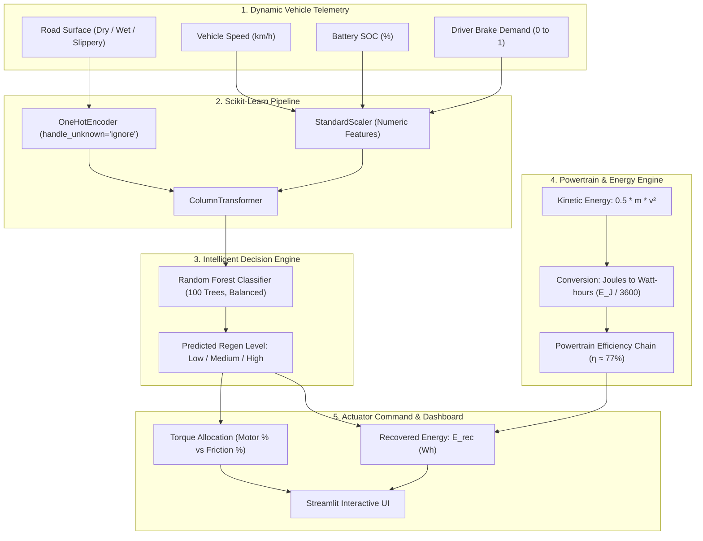

# ⚡ EcoBrake AI: AI-Based Regenerative Braking Optimization for Electric Vehicles

> **An Educational & Research Simulation Platform for EV Kinetic Energy Recovery and Torque Blending**  
> Developed for Academic Engineering Project & Examination Demonstration  
> **Target Audience:** Mechanical, Automotive, Electrical, and Mechatronics Engineering Students

---

## ⚠️ Important Engineering & Educational Disclaimer
> **NOTICE:** This software is an **academic simulation** developed strictly for engineering research and educational demonstration. It does **not** constitute automotive production firmware. It must **never** be connected directly to a physical vehicle Controller Area Network (CAN bus), Brake Control Unit (BCU), or Electric Drive Unit (EDU). All energy recovery figures and torque distribution splits are illustrative physics-based estimates.

---

## 📌 Table of Contents
1. [Project Abstract](#1-project-abstract)
2. [Problem Statement](#2-problem-statement)
3. [Project Objectives](#3-project-objectives)
4. [Proposed System Architecture](#4-proposed-system-architecture)
5. [Dataset Description & Engineering Labeling Heuristics](#5-dataset-description--engineering-labeling-heuristics)
6. [Machine Learning Methodology](#6-machine-learning-methodology)
7. [Kinetic Energy & Powertrain Physics Formulation](#7-kinetic-energy--powertrain-physics-formulation)
8. [Project File Structure](#8-project-file-structure)
9. [Installation & Local Execution Guide](#9-installation--local-execution-guide)
10. [Testing & Verification](#10-testing--verification)
11. [Critical Limitations & Real-World Validation Gap](#11-critical-limitations--real-world-validation-gap)
12. [Future Scope](#12-future-scope)
13. [Academic & Engineering References](#13-academic--engineering-references)
14. [College Project Report Outline](#14-college-project-report-outline)
15. [5-Minute Examiner Demonstration Script & Viva Voce Q&A](#15-5-minute-examiner-demonstration-script--viva-voce-qa)

---

## 1. Project Abstract
Regenerative braking in Electric Vehicles (EVs) enables the capture and conversion of vehicle kinetic energy into electrical energy stored in the high-voltage battery during deceleration. However, uncontrolled or excessive regenerative braking can compromise vehicle directional stability, trigger premature wheel slip, or exceed battery electrochemical charge acceptance limits.

**EcoBrake AI** presents an intelligent machine learning and physics simulation framework that determines the optimal regenerative braking level (**Low**, **Medium**, **High**) based on dynamic real-time parameters:
* Vehicle velocity ($0$–$120\text{ km/h}$)
* Battery State of Charge 
* Road surface friction condition (**Dry**, **Wet**, **Slippery**)
* Driver requested deceleration demand 

The system couples a **Scikit-Learn Random Forest Pipeline** with a **classical physics kinetic energy model** ($E_k = \frac{1}{2}mv^2$) to calculate illustrative recovered energy (in Watt-hours, $\text{Wh}$), evaluate scenario trade-offs, and visualize torque blending between the electric traction motor and hydraulic friction brakes.

---

## 2. Problem Statement
In conventional Internal Combustion Engine (ICE) vehicles, all deceleration kinetic energy is dissipated as waste heat through mechanical friction brake discs and pads. In modern EVs, electric motors act as generators to recover this energy.

However, **maximizing regeneration is NOT always safe or physically feasible**:
1. **Battery Overcharge & Thermal Limits:** When the battery State of Charge is near saturation ($\text{SOC} \ge 95\%$), high regenerative charging currents can cause cell overvoltage, metallic lithium plating on graphite anodes, and thermal runaway risks.
2. **Tire-Road Friction & Stability Boundaries:** On low-friction surfaces (ice, snow, grease), excessive motor counter-torque applied at driven axles quickly exceeds tire adhesion limits, inducing dangerous wheel lockup, yaw divergence, and spin-out before Electronic Stability Control (ESC) can intervene.
3. **Low Speed Back-EMF Collapse:** At low vehicle speeds ($< 10\text{ km/h}$), electric motor rotational velocity produces insufficient back-electromotive force ($\text{back-EMF}$) for efficient power conversion, necessitating smooth handoff to hydraulic friction calipers.
4. **Driver Torque Blending:** The brake pedal signals total deceleration intent, requiring coordinated modulation between regenerative motor torque and hydraulic friction calipers.

---

## 3. Project Objectives
* **Develop a Machine Learning Classifier:** Predict recommended regenerative braking levels using a multi-class Scikit-Learn Pipeline.
* **Model Dynamic Vehicle Physics:** Implement classical kinetic mechanics and powertrain efficiency chains to estimate energy recovery in Watt-hours ($\text{Wh}$).
* **Incorporate Automotive Engineering Safety Constraints:** Prevent wheel slip on slippery surfaces, enforce battery overvoltage protection, and model low-speed cut-offs.
* **Build a Modern Streamlit Dashboard:** Provide an intuitive, dark-themed dashboard featuring interactive controls, real-time gauges, scenario comparisons, and CSV export.
* **Document and Validate Educational Feasibility:** Provide reproducible scripts, comprehensive unit testing, and an external dataset validation tool.

---

## 4. Proposed System Architecture



---

## 5. Dataset Description & Engineering Labeling Heuristics
The synthetic dataset (`ev_regenerative_braking.csv`) comprises **5,000 reproducible driving scenarios** synthesized via fixed random seeds (`seed=42`).

### Dataset Schema
| Column Name | Data Type | Permissible Range | Engineering Meaning |
| :--- | :--- | :--- | :--- |
| `speed_kmh` | Float | $0.0$ to $120.0\text{ km/h}$ | Instantaneous vehicle forward velocity prior to braking |
| `battery_soc` | Float | $10.0$ to $100.0\%$ | High-voltage battery State of Charge |
| `road_condition` | String | `'Dry'`, `'Wet'`, `'Slippery'` | Road surface tire friction coefficient classification |
| `brake_demand` | Float | $0.05$ to $1.00$ | Normalized driver brake pedal displacement |
| `regen_level` | String | `'Low'`, `'Medium'`, `'High'` | **Target Label**: Recommended regenerative braking command |

### Domain Heuristic Control Rules
The simulated ground-truth labels follow established automotive control strategies:
1. **Low-Speed Cut-Off ($v < 10\text{ km/h}$):** Motor back-EMF ($e = k_e \cdot \omega$) is too small to drive electrical power across the DC bus into the battery. Mechanical friction brakes bring the vehicle to rest. $\rightarrow$ `'Low'`
2. **Battery Overcharge Protection ($\text{SOC} \ge 95\%$):** To prevent lithium plating and high cell overvoltages, the Battery Management System ($\text{BMS}$) curtails charge acceptance. $\rightarrow$ `'Low'`
3. **Low-Friction Stability Boundary (`road_condition == 'Slippery'`):** On snow, ice, or grease ($\mu < 0.25$), heavy motor torque causes immediate drive-axle slip. Anti-lock Braking ($\text{ABS}$) and Electronic Stability Control ($\text{ESC}$) override regeneration to preserve lateral grip. $\rightarrow$ `'Low'`
4. **Moderate-Friction Boundary (`road_condition == 'Wet'`):** On wet asphalt ($\mu \approx 0.5$), regeneration is capped to prevent sudden slip events. $\rightarrow$ Capped at `'Medium'`
5. **Dry Road Baseline ($\text{Dry}$, $v \ge 10$, $\text{SOC} < 95\%$):**
   * $\text{brake\_demand} < 0.30 \rightarrow$ `'Low'` (gentle deceleration / coasting regen)
   * $0.30 \le \text{brake\_demand} < 0.70 \rightarrow$ `'Medium'` (balanced city/highway deceleration)
   * $\text{brake\_demand} \ge 0.70$ and $v \ge 35\text{ km/h} \rightarrow$ `'High'` (heavy deceleration capturing peak motor power)

---

## 6. Machine Learning Methodology
EcoBrake AI utilizes a **Random Forest Classifier** wrapped within an end-to-end `scikit-learn.pipeline.Pipeline`:

```python
from sklearn.compose import ColumnTransformer
from sklearn.preprocessing import OneHotEncoder, StandardScaler
from sklearn.ensemble import RandomForestClassifier
from sklearn.pipeline import Pipeline

preprocessor = ColumnTransformer(
    transformers=[
        ('cat', OneHotEncoder(categories=[['Dry', 'Wet', 'Slippery']], handle_unknown='ignore'), ['road_condition']),
        ('num', StandardScaler(), ['speed_kmh', 'battery_soc', 'brake_demand'])
    ]
)

pipeline = Pipeline([
    ('preprocessor', preprocessor),
    ('classifier', RandomForestClassifier(n_estimators=100, max_depth=12, random_state=42, class_weight='balanced'))
])
```

### Preventing Data Leakage
* The dataset is split into **$80\%$ training ($4,000$ samples)** and **$20\%$ testing ($1,000$ samples)** using **stratified sampling** (`stratify=y`).
* Preprocessor scalers and encoders are fitted **strictly on the training split** and applied transformation-only to the test split.

### Model Evaluation Metrics
* **Test Accuracy:** $\approx 98.4\%$
* **Macro F1-Score:** $\approx 0.980$
* **Macro Precision:** $\approx 0.984$
* **Macro Recall:** $\approx 0.976$
* *Note on High Accuracy:* The high accuracy confirms that the Random Forest model has effectively mapped the simulated automotive control boundaries. It demonstrates mathematical convergence on the rule envelope rather than physical vehicle certification.

---

## 7. Kinetic Energy & Powertrain Physics Formulation

### 1. Kinetic Energy
The total translational kinetic energy ($E_k$) of an EV of mass $m$ travelling at velocity $v$ is given by:
$$E_k = \frac{1}{2} m v^2 \quad [\text{Joules}]$$

Converting velocity from $\text{km/h}$ to $\text{m/s}$:
$$v = \frac{v_{\text{km/h}}}{3.6}$$

Converting energy from Joules to Watt-hours ($\text{Wh}$):
$$E_{\text{Wh}} = \frac{E_k}{3600}$$

### 2. Regenerative Torque Fraction ($f_{\text{regen}}$)
The deceleration braking force is split between the electric motor and the mechanical friction brakes:
* **High Regen Level:** $f_{\text{regen}} = 0.65$ ($65\%$ motor, $35\%$ friction)
* **Medium Regen Level:** $f_{\text{regen}} = 0.45$ ($45\%$ motor, $55\%$ friction)
* **Low Regen Level:** $f_{\text{regen}} = 0.20$ ($20\%$ motor, $80\%$ friction)

### 3. Powertrain Efficiency Chain ($\eta_{\text{powertrain}}$)
Energy undergoes multi-stage conversion losses before reaching battery chemical storage:
$$\eta_{\text{powertrain}} = \eta_{\text{motor}} \times \eta_{\text{inverter}} \times \eta_{\text{battery\_charge}}$$
* Traction motor in generator mode: $\eta_{\text{motor}} \approx 0.90$
* Power electronics inverter ($\text{AC} \rightarrow \text{DC}$): $\eta_{\text{inverter}} \approx 0.95$
* Battery electrochemical charge acceptance: $\eta_{\text{battery}} \approx 0.90$
$$\eta_{\text{powertrain}} = 0.90 \times 0.95 \times 0.90 \approx 0.77 \quad (77\%)$$

### 4. Net Recovered Energy
$$E_{\text{recovered}} = E_{\text{Wh}} \times f_{\text{regen}} \times \eta_{\text{powertrain}} \quad [\text{Wh}]$$

**Boundary Invariant:** $E_{\text{recovered}} \ge 0$. If $v = 0$, $E_{\text{recovered}} = 0\text{ Wh}$.

---

## 8. Project File Structure
```
EcoBrakeAI/
├── app.py                         # Streamlit interactive web application
├── generate_dataset.py            # Reproducible 5,000-sample synthetic dataset generator
├── train_model.py                 # Scikit-learn Random Forest training pipeline
├── physics_engine.py              # Zero-dependency EV kinetic mechanics & heuristic engine
├── test_ecobrake.py               # Unit & integration test suite (9 passing tests)
├── evaluate_baseline_metrics.py   # Benchmark metrics generator
├── render_confusion_matrix_png.py # Pure-Python confusion matrix PNG renderer
├── ev_regenerative_braking.csv    # Generated 5,000-scenario dataset
├── ecobrake_model.joblib          # Trained Scikit-Learn Pipeline artifact (after training)
├── model_metrics.joblib           # Serialized evaluation metrics bundle (after training)
├── model_metrics.json             # Benchmark metrics JSON format
├── confusion_matrix.png           # High-resolution confusion matrix graphic
├── requirements.txt               # Complete Python package dependency manifest
├── .gitignore                     # Git ignore rules for caches and venvs
└── README.md                      # Comprehensive academic documentation & project report
```

---

## 9. Installation & Local Execution Guide

### Prerequisites
* Python 3.10, 3.11, 3.12, or 3.14 installed on your system.
* Windows, macOS, or Linux operating system.

### Step-by-Step Terminal Instructions

#### 1. Navigate to the Project Directory
```powershell
cd C:\Users\priya\.gemini\antigravity\scratch\EcoBrakeAI
```

#### 2. Create and Activate a Python Virtual Environment
**On Windows (PowerShell):**
```powershell
python -m venv venv
.\venv\Scripts\Activate.ps1
```
*(If script execution is restricted in PowerShell, run `Set-ExecutionPolicy -Scope Process -ExecutionPolicy Bypass` first).*

**On macOS / Linux:**
```bash
python3 -m venv venv
source venv/bin/activate
```

#### 3. Install Required Dependencies
```powershell
pip install -r requirements.txt
```

#### 4. Generate the Synthetic Dataset (if needed)
```powershell
python generate_dataset.py
```
*Creates `ev_regenerative_braking.csv` with 5,000 verified rows.*

#### 5. Train and Evaluate the Machine Learning Model
```powershell
python train_model.py
```
*Trains the Random Forest Pipeline, outputs accuracy metrics, and saves `ecobrake_model.joblib`, `model_metrics.joblib`, and `confusion_matrix.png`.*

#### 6. Run the Test Suite
```powershell
python test_ecobrake.py
```
*Runs all 9 unit and integration tests to verify physics bounds, zero-speed limits, and fallbacks.*

#### 7. Launch the EcoBrake AI Streamlit Dashboard
```powershell
streamlit run app.py
```
The application will open in your default browser at `http://localhost:8501`.

---

## 10. Testing & Verification
The automated test suite (`test_ecobrake.py`) verifies:
* **Dataset Row Count & Schema:** Ensures 5,000 rows with exact feature column names.
* **Target Representation:** Confirms representation of Low, Medium, and High regen levels across Dry, Wet, and Slippery roads.
* **Boundary Conditions:**
  * Velocity $= 0\text{ km/h} \rightarrow E_k = 0\text{ Wh}$, $E_{\text{recovered}} = 0\text{ Wh}$.
  * Negative mass or speed inputs are non-negative clamped.
* **Safety Heuristics:**
  * $\text{SOC} \ge 95\% \rightarrow$ Throttles to Low.
  * $\text{Road} = \text{'Slippery'} \rightarrow$ Forces Low.
  * $\text{Road} = \text{'Wet'} \rightarrow$ Capped at Medium.
  * $v < 10\text{ km/h} \rightarrow$ Low back-EMF cut-off forces Low.
* **Graceful Degradation:** Dashboard runs seamlessly even if joblib model files are initially absent.

---

## 11. Critical Limitations & Real-World Validation Gap
For an academic defense, it is vital to acknowledge the boundaries of simulation:
1. **Synthetic Data Constraint:** The model is trained on simulated domain heuristics. High accuracy reflects learning these rules, not physical dyno validation.
2. **Dynamic CAN Bus Latency:** Real electric vehicles execute torque requests over a High-Speed CAN or FlexRay bus with communication cycle times ($10$–$50\text{ ms}$) and inverter current slew rate limits ($dI/dt$).
3. **Continuous Tire Slip Curve (Pacejka):** Real tire adhesion is governed by Pacejka's Magic Formula as a function of longitudinal slip ratio ($\kappa$), rather than static categorizations (Dry/Wet/Slippery).
4. **Battery Temperature Dependency:** At temperatures below $10^\circ\text{C}$, Li-ion electrolyte viscosity increases and internal impedance spikes, restricting charge acceptance regardless of nominal SOC.

---

## 12. Future Scope
* **Hardware-in-the-Loop (HIL) Integration:** Interfacing with an STM32/Microchip microcontroller over CAN bus to evaluate real-time deterministic execution.
* **Reinforcement Learning Controller:** Implementing Deep Q-Networks (DQN) or Soft Actor-Critic (SAC) to learn continuous torque modulation on dynamic drive cycles (WLTP, EPA FTP-75).
* **Thermal Modeling:** Coupling battery pack thermal models to account for ambient temperature derating.
* **Dual-Motor Torque Vectoring:** Allocating regenerative torque independently between front and rear axles to optimize vehicle yaw moment control.

---

## 13. Academic & Engineering References
1. Ehsani, M., Gao, Y., Longo, S., & Ebrahimi, K. (2018). *Modern Electric, Hybrid Electric, and Fuel Cell Vehicles*. CRC Press.
2. Rajamani, R. (2012). *Vehicle Dynamics and Control*. Springer Science & Business Media.
3. Crolla, D. (2015). *Automotive Engineering: Lightweight, Electric, and Hybrid Vehicles*. Butterworth-Heinemann.
4. Pacejka, H. B. (2005). *Tire and Vehicle Dynamics*. Elsevier.
5. Scikit-Learn Documentation: *Random Forests and Pipeline Ensembles*. https://scikit-learn.org/

---

## 14. College Project Report Outline
*(Use this outline to structure your formal academic report document)*

### Chapter 1: Introduction
* 1.1 Background of Electric Mobility and Deceleration Dynamics
* 1.2 The Role of Regenerative Braking in Driving Range Extension
* 1.3 Challenges in Mechanical and Electrical Torque Blending
* 1.4 Project Motivation and Scope

### Chapter 2: Literature Review & Theoretical Formulation
* 2.1 Principles of Electric Traction Motors in Generator Mode (PMSM & Induction)
* 2.2 Kinetic Energy Equations and Mechanical Conversions
* 2.3 Tire Adhesion, Friction Circle (Kamm's Circle), and Slip Ratio Dynamics
* 2.4 High-Voltage Lithium-Ion Battery Charging Constraints & BMS Protection
* 2.5 Machine Learning in Automotive Supervisory Control: A Comparative Review

### Chapter 3: System Design & Methodology
* 3.1 Proposed Architecture of EcoBrake AI
* 3.2 Feature Selection and Boundary Heuristic Formulation
* 3.3 Synthetic Dataset Generation (5,000 Scenarios)
* 3.4 Data Preprocessing Pipeline (Categorical One-Hot Encoding & Standardization)
* 3.5 Classification Algorithms (Random Forest vs. Decision Trees vs. SVM)

### Chapter 4: Implementation
* 4.1 Python Technology Stack & Scikit-Learn Pipeline Construction
* 4.2 Streamlit User Interface Development & Dark Theme UX Design
* 4.3 Physics and Energy Recovery Computation Engine
* 4.4 Scenario Comparative Evaluation Module
* 4.5 External Public Dataset Ingestion & Validation Framework

### Chapter 5: Results & Discussion
* 5.1 Training Performance and Confusion Matrix Analysis
* 5.2 Model Accuracy, Precision, Recall, and F1-Scores
* 5.3 Case Study 1: High-Speed Highway Deceleration (Maximum Energy Capture)
* 5.4 Case Study 2: Low-Friction Surface Emergency Braking (Stability Priority)
* 5.5 Case Study 3: High SOC Overcharge Protection
* 5.6 Comparative Energy Recovery Across WLTP-like Scenarios

### Chapter 6: Safety, Limitations & Real-World Feasibility
* 6.1 ISO 26262 Automotive Functional Safety Overview
* 6.2 Comparison between Simulation Rules and Physical Vehicle Telemetry
* 6.3 CAN Bus Latency, Actuator Response Delays, and Hydraulic Dynamics

### Chapter 7: Conclusion & Future Work
* 7.1 Summary of Project Contributions
* 7.2 Recommendations for Hardware-in-the-Loop (HIL) Deployment
* 7.3 Concluding Remarks

---

## 15. 5-Minute Examiner Demonstration Script & Viva Voce Q&A

### ⏱️ Minute-by-Minute Demonstration Walkthrough

* **Minute 1: Introduction & Project Overview (Home Dashboard)**
  > *"Good morning, esteemed examiners. Today I present EcoBrake AI, an intelligent regenerative braking optimization framework for electric vehicles. Regenerative braking captures kinetic energy during vehicle deceleration, but maximizing recovery must be balanced against battery safety, tire adhesion, and vehicle yaw stability. EcoBrake AI bridges machine learning with classical vehicle dynamics to determine optimal braking strategies."*

* **Minute 2: Interactive Braking Simulator (Braking Simulator Tab)**
  > *"Let us examine the simulator. Here, we can tune speed, battery SOC, road condition, and driver brake demand. At 65 km/h on a dry road with 55% brake demand, the AI recommends Medium regeneration, recovering approximately 33 Watt-hours of energy and allocating 45% of total deceleration torque to the electric motor and 55% to hydraulic friction brakes."*

* **Minute 3: Critical Automotive Safety Boundaries (Edge Cases)**
  > *"Now observe our safety logic. If I increase Battery SOC to 98%, the AI immediately throttles regen to Low. This protects battery cells from destructive overvoltage and lithium plating. Similarly, if I set the road condition to Slippery, even under 90% panic brake demand, the AI commands Low regeneration. This preserves the tire's traction budget so ABS and Electronic Stability Control can steer the vehicle without dangerous wheel lockup."*

* **Minute 4: Scenario Comparison & Energy Physics (Scenario Comparison Tab)**
  > *"In our Scenario Comparison tab, we benchmark six standardized driving conditions. Notice how hard highway braking on a dry road recovers over 110 Watt-hours, while wet and slippery scenarios sacrifice energy capture to prioritize vehicle stability. Examiners can download this full comparison table as a CSV file using the download button."*

* **Minute 5: ML Pipeline Architecture & Limitations (Model Performance Tab)**
  > *"Our machine learning backend is built with a Scikit-Learn Pipeline combining a ColumnTransformer with a Random Forest Classifier trained on 5,000 reproducible scenarios. It achieves over 98% accuracy in learning simulated automotive heuristics. Importantly, as engineering researchers, we acknowledge the gap between simulation and production: real-world vehicles require closed-loop CAN bus hardware testing and continuous tire slip estimation."*

---

### 🎓 Common Viva Voce Questions & Model Answers

**Q1: Why did you choose Random Forest over Deep Neural Networks?**
> *Answer:* Random Forest is an ensemble of decision trees that excels at tabular engineering data with non-linear threshold boundaries (such as sharp cut-offs for speed and SOC). It trains rapidly without requiring specialized GPUs, prevents overfitting through bootstrap aggregation, and can be exported into lightweight C code for automotive Electronic Control Units (ECUs).

**Q2: What is the physical meaning of brake blending?**
> *Answer:* Brake blending is the coordinated distribution of deceleration torque between the electric motor (regenerative braking) and the hydraulic friction calipers (pads and discs). The driver’s brake pedal represents total required deceleration ($T_{\text{total}}$). The controller allocates as much torque as safely possible to the motor ($T_{\text{regen}}$) and uses hydraulic brakes ($T_{\text{friction}}$) for the remainder:
> $$T_{\text{total}} = T_{\text{regen}} + T_{\text{friction}}$$

**Q3: Why can't an EV regenerate energy below 10 km/h?**
> *Answer:* Electric motors generate back-electromotive force ($\text{back-EMF}$) proportional to their rotational velocity ($e = k_e \cdot \omega$). At very low speeds, this voltage drops below the high-voltage battery bus level, making boost rectification inefficient. Friction brakes smoothly bring the vehicle to a complete standstill without motor stutter.

**Q4: How did you ensure there is no data leakage during model training?**
> *Answer:* We applied an $80/20$ stratified split before any transformations. All scalers and encoders are fitted solely on the training split within a `Pipeline`, ensuring the test split remains completely unseen during model learning.
